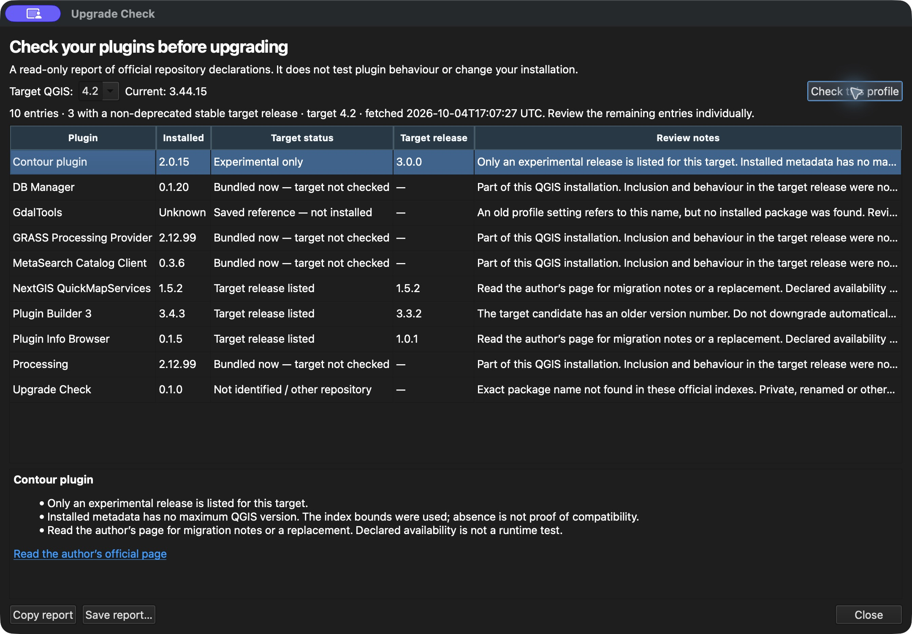

# Upgrade Check

Review your installed QGIS plugins before upgrading. Choose a target version, read the official repository declarations in one place, and save a report.

**Experimental v0.1.0 · QGIS 3.44 · Tested on macOS**

[Download the installable ZIP](https://github.com/kotijekriv/upgrade-check/releases/download/v0.1.0/upgrade-check-0.1.0.zip) · [Release notes](https://github.com/kotijekriv/upgrade-check/releases/tag/v0.1.0) · [Report an issue](https://github.com/kotijekriv/upgrade-check/issues)

This addon checks **declared availability**, not whether a plugin actually works in the target QGIS version. It never installs, enables, upgrades or downgrades your plugins.



*A historical test-profile screenshot from October 4, 2026. These are demonstration entries, not customer data or current migration advice.*

## Install

1. Download **`upgrade-check-0.1.0.zip`** from the release above. Keep it zipped. The automatically generated GitHub **Source code** downloads are developer archives, not the installable plugin.
2. In **QGIS 3.44**, open **Plugins → Manage and Install Plugins → Install from ZIP**.
3. Select the downloaded ZIP and click **Install Plugin**. Review QGIS's warning about installing a plugin from outside the official catalogue; this experimental release comes from this repository.
4. Open **Plugins → Upgrade Check → Upgrade Check…** or use its toolbar button.

The addon is not yet listed in the official QGIS plugin catalogue. There is no account, subscription or extra Python package to install. Internet access to `plugins.qgis.org` is needed for a new check. Windows and Linux QGIS hosts have not been tested. Running this addon inside QGIS 4 is not supported by this release; checking declarations for a QGIS 4 target from QGIS 3.44 is supported.

## Use

1. Enter the QGIS target you are considering, for example `4.2` or `4.2.3`.
2. Click **Check this profile**. The addon reads installed plugin metadata and saved references from the current profile and fetches the current and target public indexes.
3. Select a row to read its full notes and open the author's official page when one is available.
4. Choose **Save report…** for HTML or JSON, or **Copy report** for plain text. Changing the target clears the old report.

You can cancel a request. A failed, empty, malformed or timed-out index produces an error, not a reassuring empty result.

## Read the result

| Status | Meaning |
| --- | --- |
| Target release listed | A non-deprecated stable release has explicit bounds covering the target. It has not been runtime-tested by this addon. |
| Experimental only | Only experimental releases match. Read the author's guidance. |
| Deprecated listing | Only deprecated releases match. |
| No target release listed | The package is known, but no release with explicit matching bounds was found in the target index. This does not prove it cannot run. |
| Not identified / other repository | No exact package-name match in these official indexes. Check private repositories or renamed forks separately. |
| Bundled now — target not checked | This component comes with the current QGIS installation. Target inclusion was not checked. |
| Saved reference — not installed | The profile refers to a package that was not found installed. |
| Incomplete metadata | Required metadata could not be read or interpreted reliably. |

An older target version number is flagged for review, never treated as an instruction to downgrade. Missing maximum-version metadata is not proof of compatibility. A target can have repository declarations before QGIS itself is released.

## Example report

[HTML report](docs/demo-report.html) · [JSON report](docs/demo-report.json)

Both examples use the October 4 test profile and carry their original fetch timestamps. Download the HTML file and open it locally to view the formatted table. The examples are snapshots; run a new check for current declarations.

## Privacy

- The addon sends current/target **QGIS version numbers** to the official public index. The server receives the normal request data, including IP address and QGIS/proxy networking behaviour.
- Your plugin inventory and reports stay on your device. There is no analytics endpoint or backend.
- Reports can contain private plugin names. Review before sharing; no private project files or full profile dumps are needed to report a bug.
- The addon does not read layer contents, saved connection credentials or project files. It reads plugin metadata without importing or enabling the plugins it inspects.

## Feedback

[Open an issue](https://github.com/kotijekriv/upgrade-check/issues/new). Include your QGIS version, operating system, the action you tried and what happened. A small synthetic example is welcome. Do not upload passwords, project files or private plugin lists.

If you use this for a real upgrade check, feedback on whether the report helped you finish that task is particularly useful. Successful outside use and time savings have not yet been established.

## Development

Python 3.9+ is enough for the portable core tests and packaging. QGIS is required for the actual addon interface.

```sh
python3 -m unittest discover -s tests -v
python3 tools/build_release.py
```

The builder writes an installable ZIP, a source archive and SHA-256 checksums to `dist/`, using explicit allowlists. The source archive is for development, not QGIS's **Install from ZIP**.

The CI matrix checks the pure comparison/report code and reproducible packaging on Linux, Windows and macOS. It does not establish that the QGIS interface works on all those operating systems. See [validation scope](docs/validation.md).

## Licence and attribution

Copyright 2026 Attempts. Maintained by [kotijekriv](https://github.com/kotijekriv). Code is **GPL-3.0-or-later**; see [LICENSE](LICENSE). QGIS repository metadata belongs to its contributors and is published by `plugins.qgis.org` under **CC BY-SA 3.0**. Example reports retain that attribution. The example screenshot shows this addon with a dedicated test profile. This is an independent addon, not an official QGIS release.
